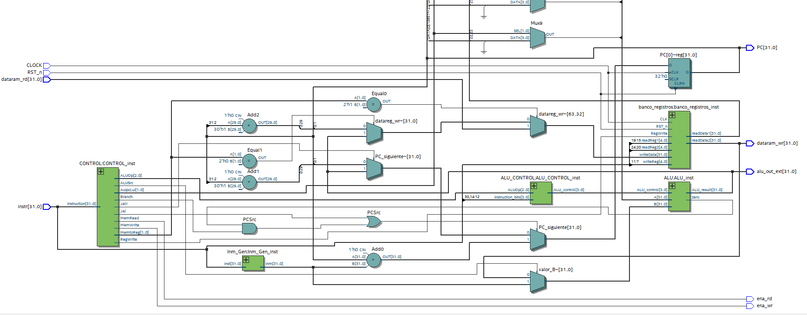
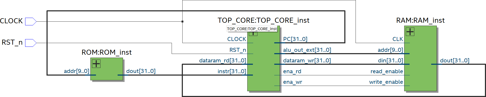
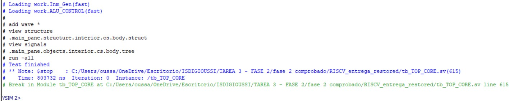
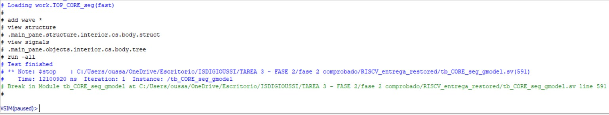
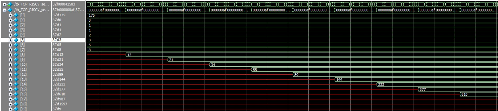
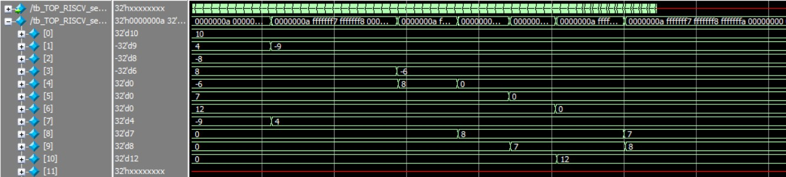

# 32-bit RISC-V Processor in SystemVerilog
[]()   

A 32-bit RISC-V educational processor implemented in SystemVerilog and developed incrementally from a single-cycle core to a five-stage pipelined architecture.

This repository is a portfolio-oriented reconstruction of a university group project. It highlights the parts that I personally contributed to or later reviewed and improved, while retaining selected group-developed files required to understand, simulate, and reproduce the processor. It includes the RTL source code, testbenches, assembly and hexadecimal test programs, simulation examples, and a complete Quartus archive (`RISCV.qar`) that can be restored to reproduce the project environment.

> **Scope:** this is an educational implementation of a **subset of RV32I**, not a complete production-ready RISC-V core.

---

## Table of Contents

- [Overview](#overview)
- [Portfolio Context](#portfolio-context)
- [My Contributions](#my-contributions)
  - [Original university project](#original-university-project)
  - [Portfolio revision](#portfolio-revision)
- [Processor Architecture](#processor-architecture)
  - [Main RTL blocks](#main-rtl-blocks)
  - [Single-cycle processor](#single-cycle-processor)
  - [Five-stage pipelined processor](#five-stage-pipelined-processor)
  - [Pipeline with hazard management](#pipeline-with-hazard-management)
- [Hazard Management](#hazard-management)
  - [Features already present in the original implementation](#features-already-present-in-the-original-implementation)
  - [Issues identified during portfolio review](#issues-identified-during-portfolio-review)
- [Supported RISC-V Instructions](#supported-risc-v-instructions)
- [Verification](#verification)
  - [Component verification](#component-verification)
  - [Single-cycle verification](#single-cycle-verification)
  - [Pipeline verification and golden model](#pipeline-verification-and-golden-model)
  - [Full-program verification](#full-program-verification)
- [Test Programs](#test-programs)
  - [Instruction test](#instruction-test)
  - [Fibonacci](#fibonacci)
  - [Selection Sort](#selection-sort)
  - [Program variants](#program-variants)
- [Simulation with QuestaSim](#simulation-with-questasim)
  - [Component simulations](#component-simulations)
  - [Full-system processor simulations](#full-system-processor-simulations)
  - [ROM and RAM initialization files](#rom-and-ram-initialization-files)
- [Running the Quartus Project](#running-the-quartus-project)
- [Repository Structure](#repository-structure)
- [GPIO Peripheral](#gpio-peripheral)
- [Tools](#tools)
- [Scope and Limitations](#scope-and-limitations)
- [Credits and Authorship](#credits-and-authorship)

---

## Overview

The project implements a simple 32-bit RISC-V processor and explores the transition from a straightforward single-cycle datapath to a five-stage pipeline.

The main stages of the project are:

1. Development and verification of the basic processor blocks.
2. Integration of a functional single-cycle processor.
3. Development of a five-stage pipeline:
   - **IF** — Instruction Fetch
   - **ID** — Instruction Decode / Register Fetch
   - **EX** — Execute
   - **MEM** — Memory Access
   - **WB** — Write Back
4. Verification of the single-cycle and pipelined processors using RISC-V programs.
5. Development of an initial hardware hazard-management implementation.
6. Later review and correction of several hazard-management corner cases for this portfolio version.

The processor uses separate instruction and data memories and supports arithmetic, logical, shift, comparison, load/store, branch, upper-immediate, and jump instructions.

---

## Portfolio Context

This repository is based on a **university group project**.

The original project contained work from several team members and also included a final FPGA-board integration stage. For this portfolio version, I removed the final board-integration files and other nonessential material that did not represent my contribution, while retaining group-developed support files required to understand and reproduce the processor.

The repository therefore focuses on:

- processor RTL,
- the single-cycle implementation,
- the pipelined implementation,
- hazard-management logic,
- verification with QuestaSim,
- assembly and hexadecimal test programs,
- and the debugging/review work carried out afterwards.

The full final FPGA-board integration is **not included** in this repository because that stage was mainly handled by other members of the group. The standalone `GPIO.sv` peripheral is retained for integration context, with its authorship explicitly identified below. The goal of this repository is not to reproduce every file from the original assignment, but to present the processor-related work in a clean and technically defensible way.

The original academic report is also not included. This README is intended to be the main self-contained technical description of the portfolio project.

---

## My Contributions

### Original university project

My responsibilities in the original group project included:

- **Project coordination**
  - task organization,
  - communication between team members,
  - tracking the different development stages,
  - helping other members debug integration problems.

- **Documentation**
  - preparation and coordination of the project documentation,
  - consolidation of information from the different project phases.

- **RTL development**
  - implementation of the `register_file`,
  - implementation of the pipelined processor core, now organized as `TOP_CORE_pipeline.sv`,
  - development of the original hazard-management attempt.

- **Verification with QuestaSim**
  - verification of the single-cycle `TOP_CORE`,
  - verification of the pipelined `TOP_CORE`,
  - verification of the single-cycle `TOP_RISCV`,
  - verification of the pipelined `TOP_RISCV`,
  - debugging of simulation setup and comparison issues between the single-cycle and pipelined versions.

The testbenches used during these verification tasks were part of the group project. **I used and debugged them for verification, but I did not author the testbenches themselves.**

### Portfolio revision

When preparing this repository for my portfolio, I revisited the project and performed additional work:

- reorganized the source code into a cleaner repository structure,
- translated identifiers and comments to English where appropriate,
- removed project sections that did not represent my contribution,
- reviewed interfaces and module naming for consistency,
- re-tested the single-cycle and pipelined implementations,
- reviewed the original hazard-management design,
- identified several issues that were not detected during the original project,
- corrected those issues in a separate revised hazard-management implementation,
- prepared dedicated hexadecimal program variants for the hazard-managed processor,
- and packaged a complete Quartus archive for reproducibility.

The original hazard implementation has deliberately been preserved as:

```text
rtl/TOP_CORE_pipeline_hazards_original.sv
```

while the revised implementation is:

```text
rtl/TOP_CORE_pipeline_hazards.sv
```

This makes it possible to compare the original design with the later corrections.

---

## Processor Architecture

### Main RTL blocks

The processor is built from a small set of reusable SystemVerilog modules:

| Module | Purpose |
|---|---|
| `ALU.sv` | Arithmetic, logical, shift, comparison, and branch-condition evaluation |
| `ALU_CONTROL.sv` | Converts `ALUOp` and instruction function bits into the ALU operation |
| `CONTROL.sv` | Main instruction decoder and control-signal generator |
| `Imm_Gen.sv` | Immediate extraction and sign extension |
| `register_file.sv` | 32 × 32-bit register file with `x0` hardwired to zero |
| `ROM.sv` | Instruction memory initialized with `$readmemh` |
| `RAM.sv` | Data memory with synchronous writes and combinational reads |
| `TOP_CORE.sv` | Single-cycle processor core |
| `TOP_CORE_pipeline.sv` | Five-stage pipelined processor core |
| `TOP_CORE_pipeline_hazards_original.sv` | Original hazard-management attempt |
| `TOP_CORE_pipeline_hazards.sv` | Revised hazard-managed pipeline |
| `TOP_RISCV*.sv` | Top-level modules integrating core, ROM, and RAM |

---

### Single-cycle processor

`TOP_CORE.sv` contains the processor datapath and control logic, while `TOP_RISCV.sv` integrates the core with instruction ROM and data RAM.

In the single-cycle version, each instruction completes its entire datapath operation within one clock cycle.



The complete system connects the instruction memory, processor core, and data memory:



The single-cycle implementation was used as the first functional reference for the project and later as a golden model when checking the pipelined core.

---

### Five-stage pipelined processor

`TOP_CORE_pipeline.sv` divides instruction execution into five stages:

```text
IF  ->  ID  ->  EX  ->  MEM  ->  WB
```

Pipeline registers separate the stages:

- IF/ID
- ID/EX
- EX/MEM
- MEM/WB

This allows several instructions to be in flight simultaneously.

The initial pipelined implementation does **not** resolve hazards entirely in hardware. For this reason, the `_pipeline` program images contain explicitly inserted NOP instructions to separate dependent operations and control transfers.

This version is useful because it clearly shows the architectural transition from a single-cycle processor to a pipeline before adding hazard-handling logic.

---

### Pipeline with hazard management

The project also contains two hazard-management implementations:

```text
TOP_CORE_pipeline_hazards_original.sv
TOP_CORE_pipeline_hazards.sv
```

The first file preserves the version developed during the original university project.

The second file is a later revision created while preparing the project for this portfolio. It keeps the original structure but corrects several cases that were either incomplete or not identified during the original development.

Dedicated program files with the `_hazards` suffix are included for this version.

---

## Hazard Management

### Features already present in the original implementation

The original hazard-management version already contained a substantial amount of pipeline control logic:

| Feature | Original implementation |
|---|:---:|
| IF/ID/EX/MEM/WB pipeline | ✅ |
| MEM -> EX forwarding | ✅ |
| WB -> EX forwarding | ✅ |
| MEM forwarding priority over WB | ✅ |
| `rs2` forwarding for `SW` | ✅ |
| Basic load-use hazard detection | ✅ |
| PC freeze during load-use hazard | ✅ |
| IF/ID freeze during load-use hazard | ✅ |
| ID/EX bubble insertion | ✅ |
| Branch resolution in MEM | ✅ |
| JAL handling | ✅ |
| JALR handling | ✅ |

The original design therefore already addressed the main concepts normally introduced when studying pipeline hazards: forwarding, stalling, bubbles, and control transfers.

---

### Issues identified during portfolio review

While reviewing the original design for this portfolio, I found several cases that required correction.

#### 1. JALR target alignment

The original implementation used the ALU result directly as the JALR target.

RISC-V requires bit 0 of the JALR destination to be cleared:

```text
target = (rs1 + immediate) & ~1
```

The revised version explicitly forces the least significant bit to zero.

#### 2. Incomplete control-hazard flush

The original control-hazard logic flushed IF/ID when a branch or jump was resolved, but younger instructions could already be present in later pipeline stages.

The revised version invalidates the younger instructions that must not complete after a taken control transfer.

#### 3. Branch versus stall priority

The original design used the stall signal directly to disable PC writes.

This creates a corner case when a taken control transfer and a data stall occur at the same time: the PC redirect must take priority over the stall.

The revised implementation gives a resolved branch/jump priority over the normal data-hazard freeze.

#### 4. Missing WB -> ID bypass

The original forwarding network handled dependencies reaching the EX stage, but it did not explicitly cover the case where WB writes a register in the same cycle that ID reads it.

A WB-to-ID bypass path was added in the revised version.

#### Additional cleanup

The later revision also included smaller improvements:

- avoiding false stalls for instructions that do not actually use `rs1` or `rs2`,
- more complete reset initialization,
- more complete bubble clearing,
- consistent module/interface names,
- and English naming/documentation cleanup.

Keeping both versions in the repository is intentional: it documents the development and debugging process rather than hiding the original implementation.

---

## Supported RISC-V Instructions

The processor implements the following 31 instructions from the RV32I instruction set.

### Arithmetic and logical

| Register | Immediate |
|---|---|
| `ADD` | `ADDI` |
| `SUB` | |
| `AND` | `ANDI` |
| `OR` | `ORI` |
| `XOR` | `XORI` |

### Shifts

| Register | Immediate |
|---|---|
| `SLL` | `SLLI` |
| `SRL` | `SRLI` |
| `SRA` | `SRAI` |

### Comparisons

| Register | Immediate |
|---|---|
| `SLT` | `SLTI` |
| `SLTU` | `SLTIU` |

### Memory

- `LW`
- `SW`

### Conditional branches

- `BEQ`
- `BNE`
- `BLT`
- `BLTU`
- `BGE`
- `BGEU`

### Upper-immediate instructions

- `LUI`
- `AUIPC`

### Jumps

- `JAL`
- `JALR`

---

## Verification

Verification was a major part of the original project.

The repository contains both unit-level testbenches and processor-level testbenches.

The included testbenches were used for both unit-level and processor-level verification.

---

### Component verification

The repository includes testbenches for individual blocks:

```text
testbenches/tb_ALU.sv
testbenches/tb_ALU_CONTROL.sv
testbenches/tb_RAM.sv
testbenches/tb_ROM.sv
testbenches/tb_register_file.sv
```

These simulations are straightforward because each testbench only needs its corresponding design module and does not require a special simulation script.

---

### Single-cycle verification

The main single-cycle testbenches are:

```text
testbenches/tb_TOP_CORE.sv
testbenches/tb_TOP_RISCV.sv
```

`tb_TOP_CORE.sv` uses assertions to check processor behavior.



The full `TOP_RISCV` simulation integrates the ROM, processor core, and RAM so that complete programs can be executed.

---

### Pipeline verification and golden model

The pipelined processor was also compared against the already verified single-cycle implementation.

The single-cycle `TOP_CORE` acts as a **golden model**, while the pipelined core is the design under comparison.

The relevant testbench is:

```text
testbenches/tb_TOP_CORE_pipeline_gmodel.sv
```

This approach made it possible to compare the architectural results produced by both implementations despite their different timing behavior.



For the tested cases, the assertions included in the corresponding testbenches completed successfully.

---

### Full-program verification

Three main program sets are included:

- instruction-by-instruction functional test,
- Fibonacci sequence,
- Selection Sort.

The single-cycle and original pipelined versions were checked using these programs.

Example Fibonacci simulation:



Example Selection Sort simulation:



Dedicated `_hazards` machine-code program images are included for the revised hazard-managed version.

---

## Test Programs

All test programs are located in:

```text
programs/
```

For each main program, the repository contains:

- assembly source,
- hexadecimal instruction image,
- pipeline version,
- hazard-managed version,
- and the RAM initialization file where required.

---

### Instruction test

The `Instructions` program exercises the implemented instruction subset, including:

- arithmetic,
- logical operations,
- shifts,
- comparisons,
- loads and stores,
- conditional branches,
- `LUI`,
- `AUIPC`,
- `JAL`,
- and `JALR`.

Relevant files include:

```text
ASSEMBLYInstructions.txt
ASSEMBLYInstructions_pipeline.txt
ASSEMBLYInstructions_hazards.txt

Instructions.txt
Instructions_pipeline.txt
Instructions_hazards.txt

RAM_Instructions.txt
```

---

### Fibonacci

The Fibonacci program verifies repeated arithmetic operations, register dependencies, memory accesses, pointer updates, and a conditional branch loop.

Relevant files:

```text
ASSEMBLYFibonacci.txt
ASSEMBLYFibonacci_pipeline.txt
ASSEMBLYFibonacci_hazards.txt

Fibonacci.txt
Fibonacci_pipeline.txt
Fibonacci_hazards.txt

RAM_Fibonacci.txt
```

`RAM_Fibonacci.txt` contains the initial value **N**, which determines how many Fibonacci terms are generated.

For example:

```text
0000000A
```

means:

```text
N = 10
```

This value controls the program input; it is **not** the number of simulator clock cycles.

---

### Selection Sort

The Selection Sort program provides a more complex test because it combines:

- repeated loads and stores,
- signed comparisons,
- nested loops,
- branches,
- pointer arithmetic,
- and data movement.

Relevant files:

```text
ASSEMBLYSelection_sort.txt
ASSEMBLYSelection_sort_pipeline.txt
ASSEMBLYSelection_sort_hazards.txt

Selection_sort.txt
Selection_sort_pipeline.txt
Selection_sort_hazards.txt

RAM_Selection_sort.txt
```

---

### Program variants

The naming convention reflects the processor version for which each image was prepared.

#### Basic / single-cycle

```text
Fibonacci.txt
Instructions.txt
Selection_sort.txt
```

#### Pipeline without complete hardware hazard handling

```text
Fibonacci_pipeline.txt
Instructions_pipeline.txt
Selection_sort_pipeline.txt
```

These versions contain explicit NOP instructions where required to avoid unresolved pipeline dependencies.

#### Pipeline with hazard management

```text
Fibonacci_hazards.txt
Instructions_hazards.txt
Selection_sort_hazards.txt
```

These are intended for the hazard-managed processor, where dependency handling is moved into the hardware rather than being handled through manually inserted NOPs.

---

## Simulation with QuestaSim

A `.do` script is **not required** for the simulations in this repository.

The simulations can be run directly from QuestaSim once the appropriate design files and testbench are compiled.

---

### Component simulations

For simple component testbenches such as:

```text
tb_ALU
tb_ALU_CONTROL
tb_RAM
tb_ROM
tb_register_file
```

no special setup is required beyond compiling the DUT and its testbench and running the simulation.

---

### Full-system processor simulations

For the complete processor simulations:

```text
tb_TOP_RISCV
tb_TOP_RISCV_pipeline
tb_TOP_RISCV_pipeline_hazards
```

the program and RAM initialization files to be used in the simulation are selected directly in the corresponding `TOP_RISCV*.sv` module.

The hexadecimal program executed by the processor is specified through the ROM `INIT_FILE` parameter:

```systemverilog
ROM #(
    .WIDTH(32),
    .DEPTH(1024),
    .INIT_FILE("Instructions_pipeline.txt")
) ROM_inst
```

The initial contents of the data memory are specified through the RAM `INIT_FILE` parameter:

```systemverilog
RAM #(
    .INIT_FILE("RAM_Instructions.txt")
) RAM_inst
```

The selected ROM and RAM files must correspond to the same test program. For example, `Fibonacci_pipeline.txt` should be used together with `RAM_Fibonacci.txt`.

The program file must also correspond to the processor version:

```text
Single-cycle:
Fibonacci.txt
Instructions.txt
Selection_sort.txt

Pipeline:
Fibonacci_pipeline.txt
Instructions_pipeline.txt
Selection_sort_pipeline.txt

Pipeline with hazard management:
Fibonacci_hazards.txt
Instructions_hazards.txt
Selection_sort_hazards.txt
```

The most useful result is the final content of the instantiated data RAM.

A practical QuestaSim workflow is:

1. Confirm the desired ROM and RAM initialization files in the corresponding `TOP_RISCV*.sv` module.
2. Compile the required RTL modules and the desired `tb_TOP_RISCV*` testbench.
3. Start the simulation.
4. In the DUT hierarchy, locate the `RAM_inst` instance.
5. Add the internal RAM memory array (`mem`) to the Wave window.
6. Restart the simulation so that the testbench reset sequence is applied from the beginning.
7. Use **Run -All**.
8. Inspect `RAM_inst.mem` to verify the program result.

Typical Tcl commands after the simulation has been loaded are:

```tcl
restart -f
run -all
```

The RAM array can be added graphically from the QuestaSim hierarchy/Objects window. Its exact hierarchical path depends on the selected top-level testbench.

---

### ROM and RAM initialization files

The ROM and RAM modules use `$readmemh` initialization files.

For QuestaSim, the required `.txt` files must be available in the simulator working directory.

With the original Quartus project restored from `RISCV.qar`, the required files are already included in the default simulation working directory:

```text
simulation/modelsim/
```

For Quartus compilation, the initialization files are also included in the project alongside the design files.

The clean `programs/` directory in this repository is intended for browsing and understanding the test programs. The QAR contains the copies in the locations required by the original Quartus/QuestaSim project.

---

## Running the Quartus Project

The recommended way to reproduce the complete working Quartus project is to use:

```text
RISCV.qar
```

The archive is included in the repository root.

In Quartus Prime:

1. Restore the archived project from `RISCV.qar`.
2. Open the restored project.
3. Select the desired top-level processor version or simulation testbench.
4. Compile or launch QuestaSim as required.

The QAR contains the project configuration, RTL source files, testbenches, and the ROM/RAM initialization files required by the project.

The source directories in this GitHub repository are reorganized primarily for readability, while the QAR provides the reproducible Quartus project structure.

---

## Repository Structure

```text
.
|-- RISCV.qar
|
|-- docs/
|   `-- images/
|       |-- fibonacci_simulation.jpg
|       |-- pipeline_golden_model_assertions.jpg
|       |-- selection_sort_simulation.jpg
|       |-- single_cycle_assertions.jpg
|       |-- single_cycle_rtl.png
|       `-- system_rtl.png
|
|-- programs/
|   |-- ASSEMBLYFibonacci.txt
|   |-- ASSEMBLYFibonacci_hazards.txt
|   |-- ASSEMBLYFibonacci_pipeline.txt
|   |-- ASSEMBLYInstructions.txt
|   |-- ASSEMBLYInstructions_hazards.txt
|   |-- ASSEMBLYInstructions_pipeline.txt
|   |-- ASSEMBLYSelection_sort.txt
|   |-- ASSEMBLYSelection_sort_hazards.txt
|   |-- ASSEMBLYSelection_sort_pipeline.txt
|   |-- Fibonacci.txt
|   |-- Fibonacci_hazards.txt
|   |-- Fibonacci_pipeline.txt
|   |-- Instructions.txt
|   |-- Instructions_hazards.txt
|   |-- Instructions_pipeline.txt
|   |-- RAM_Fibonacci.txt
|   |-- RAM_Instructions.txt
|   |-- RAM_Selection_sort.txt
|   |-- Selection_sort.txt
|   |-- Selection_sort_hazards.txt
|   `-- Selection_sort_pipeline.txt
|
|-- rtl/
|   |-- ALU.sv
|   |-- ALU_CONTROL.sv
|   |-- CONTROL.sv
|   |-- GPIO.sv
|   |-- Imm_Gen.sv
|   |-- RAM.sv
|   |-- register_file.sv
|   |-- ROM.sv
|   |-- TOP_CORE.sv
|   |-- TOP_CORE_pipeline.sv
|   |-- TOP_CORE_pipeline_hazards.sv
|   |-- TOP_CORE_pipeline_hazards_original.sv
|   |-- TOP_RISCV.sv
|   |-- TOP_RISCV_pipeline.sv
|   `-- TOP_RISCV_pipeline_hazards.sv
|
`-- testbenches/
    |-- tb_ALU.sv
    |-- tb_ALU_CONTROL.sv
    |-- tb_RAM.sv
    |-- tb_register_file.sv
    |-- tb_ROM.sv
    |-- tb_TOP_CORE.sv
    |-- tb_TOP_CORE_pipeline.sv
    |-- tb_TOP_CORE_pipeline_gmodel.sv
    |-- tb_TOP_RISCV.sv
    |-- tb_TOP_RISCV_pipeline.sv
    `-- tb_TOP_RISCV_pipeline_hazards.sv
```

---

## GPIO Peripheral

`GPIO.sv` is included because it is a useful example of how the processor can interact with an external peripheral.

The module provides:

- 16 switch inputs,
- 16 LED outputs,
- four seven-segment displays,
- a simple bus-side read/write interface.

However, **I did not design this GPIO module**. It was part of the original group-project infrastructure and is included for completeness and peripheral-integration context.

The rest of the final FPGA-board integration has intentionally been excluded from this portfolio repository because that stage was mainly developed by other teammates.

---

## Tools

The project was developed and verified using:

- **SystemVerilog**
- **Intel Quartus Prime**
- **QuestaSim / ModelSim**
- **RISC-V assembly**
- hexadecimal ROM/RAM initialization files using `$readmemh`

The original project environment used **Intel Quartus Prime Lite 17.1**.

---

## Scope and Limitations

This project is an educational processor implementation intended to explore CPU datapaths, control, pipelining, verification, and hazard management.

It is not intended to be a complete or production-ready RISC-V core.

The repository focuses on the implemented RV32I subset and does not include features such as:

- caches,
- interrupts,
- privilege modes,
- CSR support,
- virtual memory,
- branch prediction,
- superscalar execution,
- or other advanced microarchitectural features.

The original pipelined implementation uses explicitly inserted NOPs in the `_pipeline` programs because hardware hazard handling was not complete in that version.

A later hazard-managed implementation adds hardware mechanisms for forwarding, stalling, and control-hazard handling, with the original version preserved for comparison.

---

## Credits and Authorship

This project originated as a **university group project**. Detailed information about my original responsibilities and later portfolio work is provided in the [My Contributions](#my-contributions) section above.

### Group-project material retained in the repository

This repository also contains material developed collaboratively or by other members of the original university project. It has been retained where necessary to understand, simulate, and reproduce the processor as a complete system.

This includes:

- the testbenches, which I used extensively for verification and debugging but did not originally author,
- the assembly and hexadecimal test programs used to verify the processor,
- several supporting RTL modules that were developed by other members of the group,
- `GPIO.sv`, which was developed as part of the group project but not by me.

I do not claim individual authorship of these files. They are included because they form part of the technical context required to reproduce and understand the processor.

This distinction is intentional: the purpose of this repository is to document both the technical project and my actual contribution to it as accurately as possible.
